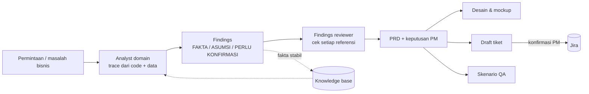

# Muhammad Faizal Ayatullah — Product Manager, Operations

PM untuk produk operasional (inventory, gudang/WMS, procurement, order, logistik) di perusahaan e-grocery produk segar di Indonesia.
Saya bukan developer, tetapi saya membangun **sistem kerja berbasis AI** yang membuat saya bisa membaca codebase produksi, memetakan proses bisnis dari code, dan mengubahnya menjadi PRD, desain, dan tiket yang siap dikerjakan tim engineering.

> Halaman web: buka `index.html` atau GitHub Pages repo ini.
> Semua contoh di bawah sudah disamarkan. Nama perusahaan, vendor, sistem internal, dan angka bisnis tidak ditampilkan.

---

## Ringkasan

| | |
|---|---|
| **Fokus** | Product management untuk operasional: inventory, WMS, procurement & AP, production kitchen, last-mile, katalog & promo |
| **Pendekatan** | Analisis berbasis bukti dari code dan data, bukan asumsi; setiap klaim punya referensi |
| **Output (±3 bulan)** | 210+ dokumen analisis proses · 27 PRD & desain · 60+ draft tiket · 5 paket skenario QA |
| **Tools** | Claude Code (agent, command, skill), BigQuery, n8n, Google Chat API, Figma, Jira, Python |

---

## 1. Sistem kerja PM berbasis AI

**Masalah.** Produk operasional terdiri dari banyak aplikasi (web admin, aplikasi gudang, backend, sistem order). Untuk tahu "sistem sekarang sebenarnya bekerja seperti apa", PM biasanya harus menunggu waktu engineer. Jawaban lisan sering tidak lengkap, dan keputusan diambil dari asumsi.

**Yang saya bangun.** Workspace Claude Code dengan **19 agent spesialis**, **6 command**, dan **2 skill**, yang bekerja di atas salinan codebase *read-only*:

- **Analyst per domain**: procurement, inventory, fulfillment, logistik, order, katalog, approval, integrasi, laporan. Masing-masing tahu istilah dan risiko domainnya.
- **Pipeline fitur** (`/feature`): trace proses → review → PRD → desain → draft tiket, dengan jeda konfirmasi PM di setiap tahap.
- **Reviewer**: agent terpisah yang memeriksa setiap referensi benar-benar mendukung klaimnya sebelum dokumen dipakai.
- **Penulis**: PRD writer, UX designer, Jira writer (hanya membuat tiket setelah konfirmasi), QA tester (setiap requirement wajib tertutup skenario test).
- **Pengaman**: codebase tidak boleh diubah; query data wajib lewat cek biaya (dry run) sebelum dijalankan.

**Aturan kualitas yang saya tetapkan**

- Setiap klaim tentang sistem diberi label: **[FAKTA]** (terbukti dari code, dengan referensi file:baris), **[ASUMSI]**, **[PERLU KONFIRMASI]** (otomatis masuk daftar pertanyaan ke tim), **[USULAN]** (perilaku baru, hanya di PRD).
- Kerangka analisis seragam: ringkasan PM → alur → status & transisi → role & approval → aturan bisnis → perbedaan aplikasi mobile vs web → gap → pertanyaan → referensi.
- Tingkat gap seragam: **Tinggi** (kerugian uang, selisih stok, celah kontrol), **Sedang** (butuh workaround), **Rendah** (UX/audit), dipetakan langsung ke prioritas Jira.
- Fakta yang sudah stabil dipindahkan ke *knowledge base* per domain, sehingga analisis berikutnya tidak mulai dari nol.

**Hasil**
- Pertanyaan "sistem sekarang bagaimana?" terjawab dalam hitungan jam, lengkap dengan bukti, tanpa menyita waktu engineer.
- Diskusi dengan engineering dimulai dari fakta yang bisa dicek, bukan dari ingatan.
- Gap kontrol (mis. approval yang bisa dilewati, stok yang bisa selisih) ditemukan sebelum menjadi insiden.

---

## 2. Studi kasus produk

### 2.1 Purchase Invoice & buku hutang supplier (AP)
**Konteks.** Hutang ke supplier tidak tercatat di sistem mana pun; Finance mengelolanya di luar sistem.
**Peran saya.** Memetakan alur PO sampai tagihan dari code, menyusun PRD bersama Finance dan Purchasing, mendesain layar, dan memecah tiket BE/FE/QA.
**Solusi Fase 1**
- Purchase Invoice untuk satu atau beberapa PO; final saat disimpan (hutang terbentuk, PO ditutup, deposit terpotong).
- Pelunasan lewat *bulk upload* bukti bayar per invoice.
- Kartu hutang per supplier dengan umur hutang (AP aging).
- Ledger hutang yang tidak bisa diubah atau dihapus.
- Kontrol lewat hak akses menu yang juga dicek di backend.
**Yang saya pelajari.** PRD direvisi tiga kali (v1 → v2.0). Versi akhir justru lebih sederhana: tanpa draft/void, tanpa integrasi pembayaran otomatis, agar bisa rilis dalam batas 2 sprint.

### 2.2 Production kitchen: resep, pemotongan stok bahan, dan COGS
**Konteks.** Dapur produksi mengolah bahan baku menjadi produk jadi, tetapi stok bahan tidak terpotong sesuai pemakaian dan COGS tidak akurat.
**Solusi**
- **Model hybrid**: resep menjadi nilai awal, stok dipotong dari pemakaian aktual per work order.
- Sisa lebih, waste, dan selisih tercatat sebagai pergerakan stok otomatis.
- Program dipecah: Fase 1 COGS (resep dari master yang sudah ada), Fase 2 pemakaian aktual.
**Yang saya pelajari.** 29 keputusan tercatat dalam log keputusan PRD (D1–D29). Mengikuti log ini, scope terus diperkecil: modul resep baru dibatalkan dan memakai master yang sudah ada, sementara fitur substitusi bahan dikeluarkan karena operasional tidak membutuhkannya.

### 2.3 Aplikasi driver in-house & live tracking
**Konteks.** Armada sendiri memakai aplikasi pihak ketiga, sehingga perusahaan tidak punya posisi driver secara live, pelanggan tidak bisa melacak di peta, dan data gagal kirim tersebar.
**Solusi.** Program tiga fase:
1. Driver tracker: lokasi live, peta *control tower* untuk dispatcher, halaman tracking pelanggan.
2. Mengganti aplikasi pihak ketiga untuk last-mile instant/same-day: ambil tugas, scan serah terima, rute, status, bukti terima.
3. Gagal kirim & retur, middle-mile, next-day.
**Peran saya.** Sizing dari code (lebih dari 10 service terdampak), memetakan semua titik ketergantungan ke vendor, PRD, dan mockup 10 layar.

### 2.4 Logic replenishment berbasis forecast
**Konteks.** Pengisian ulang rak pick (pickface) dihitung manual di spreadsheet.
**Solusi.** Prioritas refill P0/P1/P2 dari forecast dan target stok, memakai stok realtime per area. Override manual tetap boleh, tetapi wajib beri alasan bila deviasi melewati ambang, dan editan manual diberi penanda.

### 2.5 Clearance sale: dari spreadsheet ke sistem
**Konteks.** Daftar harga clearance diisi di spreadsheet, lalu diproses otomasi. Baris tidak valid terbuang tanpa pesan, label tanggal kedaluwarsa bisa hilang saat campaign diedit, dan tidak ada approval maupun jejak perubahan.
**Solusi.** Desain 7 layar di dashboard marketing: validasi per baris dengan alasan yang terlihat, approval untuk harga di bawah batas wajar, konfirmasi eksplisit sebelum promo live dinonaktifkan, dan riwayat perubahan.

### 2.6 Promo "Beli Banyak Lebih Hemat"
**Konteks.** Commercial ingin menaikkan jumlah item per order lewat diskon *mix & match* lintas SKU.
**Peran saya.** Mengecek kemampuan engine promo yang sudah ada dari code. Hasilnya, sebagian besar mekanisme sudah tersedia, jadi PRD fokus ke gap yang sebenarnya belum ada, bukan membangun ulang.

---

## 3. Otomasi & tools data

| Tool | Fungsi |
|---|---|
| **Bot Q&A di Google Chat** | Tim cukup menulis `#tanya …` di chat. Bot menjawab dari knowledge base, dokumen analisis, dan code, lengkap dengan referensi, serta membawa konteks percakapan di thread. |
| **Pipeline metrik operasional mingguan** | Availability, stock gap, unfulfillment, dan waste per gudang dari BigQuery. Biaya scan diestimasi dulu, dan query berhenti otomatis bila melewati batas. |
| **Cost guard BigQuery** | Skill yang mewajibkan dry run sebelum query apa pun, lalu memutuskan aman dijalankan atau harus minta konfirmasi. |
| **Workflow n8n** | Rotasi otomatis section homepage (top-30 produk), duplikasi SKU untuk tier khusus, dan draft SKU baru dari spreadsheet. |
| **QA E2E di staging** | Agent yang menjalankan skenario test di browser berdasarkan file skenario. Setiap aksi yang mengubah data wajib dikonfirmasi dulu. |
| **Weekly report otomatis** | Menyusun laporan mingguan dari tiket Jira dan dokumen kerja ke satu dokumen hidup. |
| **Code knowledge graph** | Indeks codebase per domain agar pencarian lintas service lebih cepat dan murah. |

---

## 4. Cara saya bekerja

1. **Bukti dulu, opini kemudian.** Setiap klaim tentang sistem bisa ditelusuri ke code atau data.
2. **Pisahkan fakta, asumsi, dan usulan.** Stakeholder selalu tahu mana yang sudah pasti dan mana yang masih harus diputuskan.
3. **Catat keputusan.** PRD menyimpan log keputusan bertanggal (siapa memutuskan apa dan dampaknya), sehingga perubahan scope bisa dijelaskan.
4. **Scope kecil yang bisa rilis.** Satu project maksimal 2 sprint. Fase berikutnya tidak dicampur ke tiket fase berjalan.
5. **Otomasi pekerjaan berulang, tapi manusia tetap memutuskan.** Agent membuat draft. Tiket, pesan, dan perubahan data hanya dikirim setelah saya konfirmasi.

---

## Kontak
- LinkedIn: _(isi)_
- Email: _(isi)_
